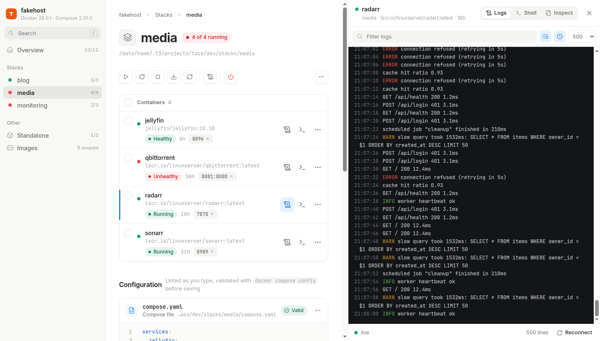
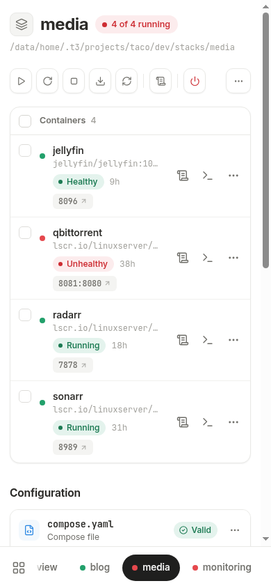

# taco

**TA**ltiko **CO**ntainers. That's where the name comes from.

A small, mobile-first web client for Docker Compose hosts. It just drives the
`docker` CLI: no database, no lock-in. Manage stacks from your shell, from taco, or both.





## Run

```yaml
services:
  taco:
    image: taco
    ports:
      - "8080:8080"
    volumes:
      - /var/run/docker.sock:/var/run/docker.sock
      - /opt/stacks:/stacks   # your compose stacks
```

Then open `http://<host>:8080`.

> There is no auth, by design. It's root on the host, so only expose it on a trusted network.
